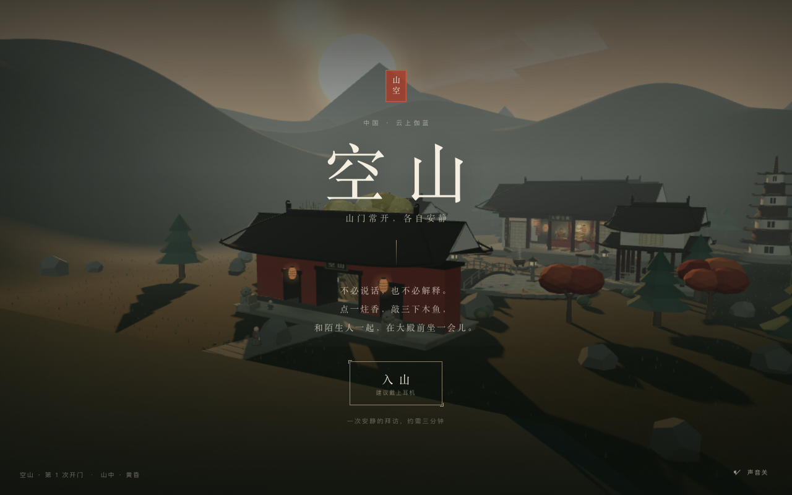
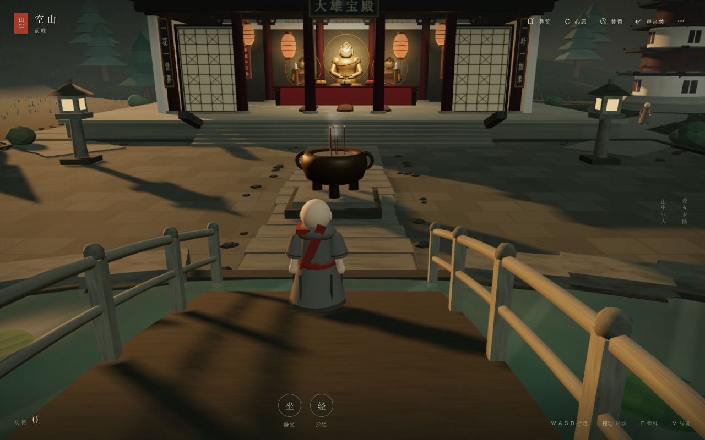
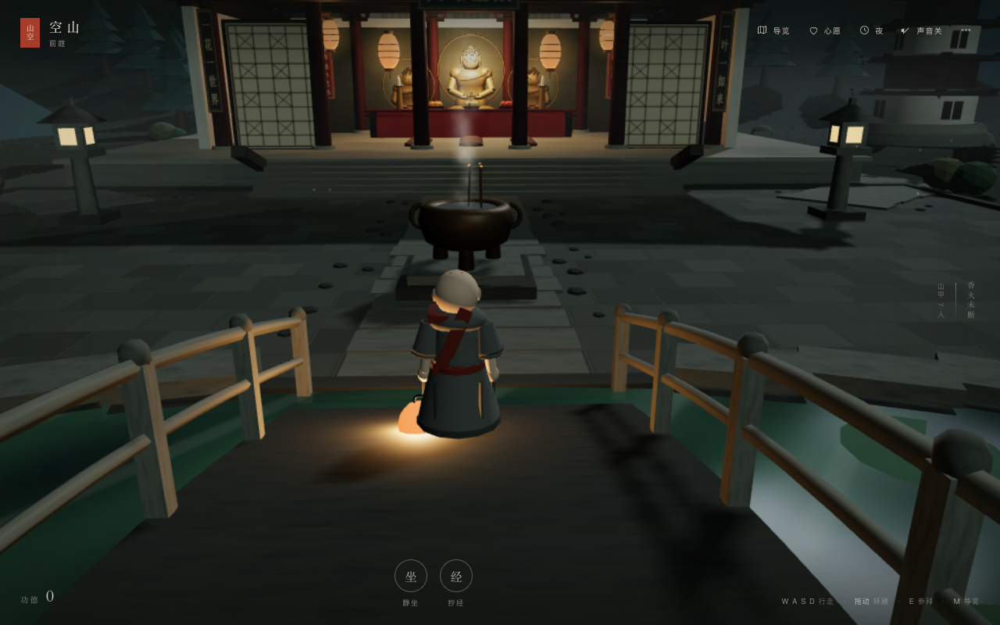
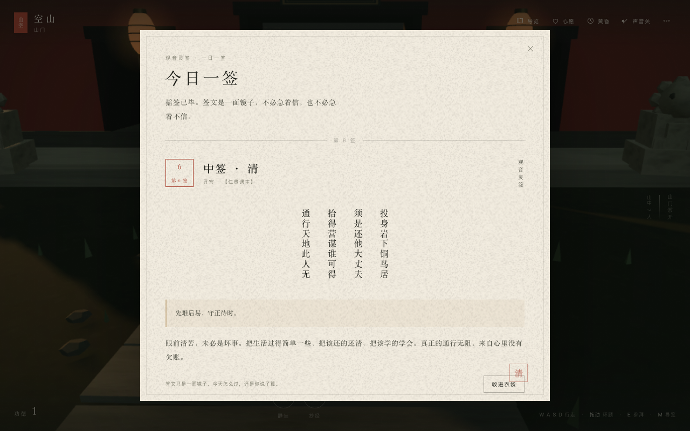
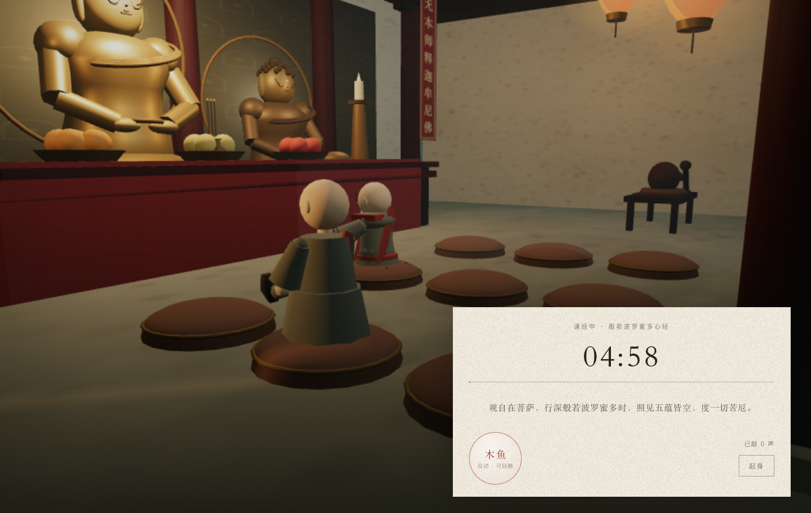
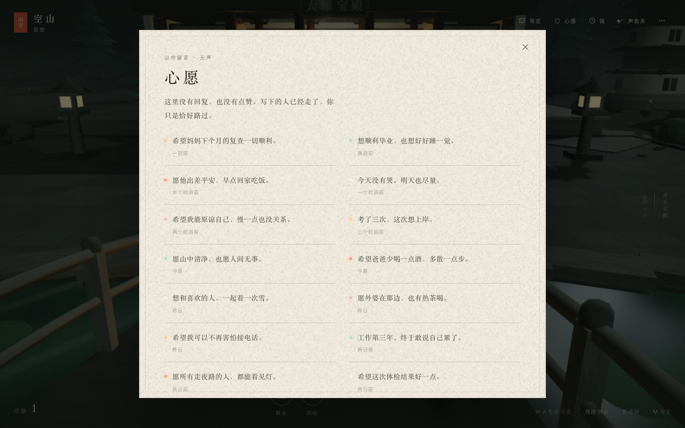
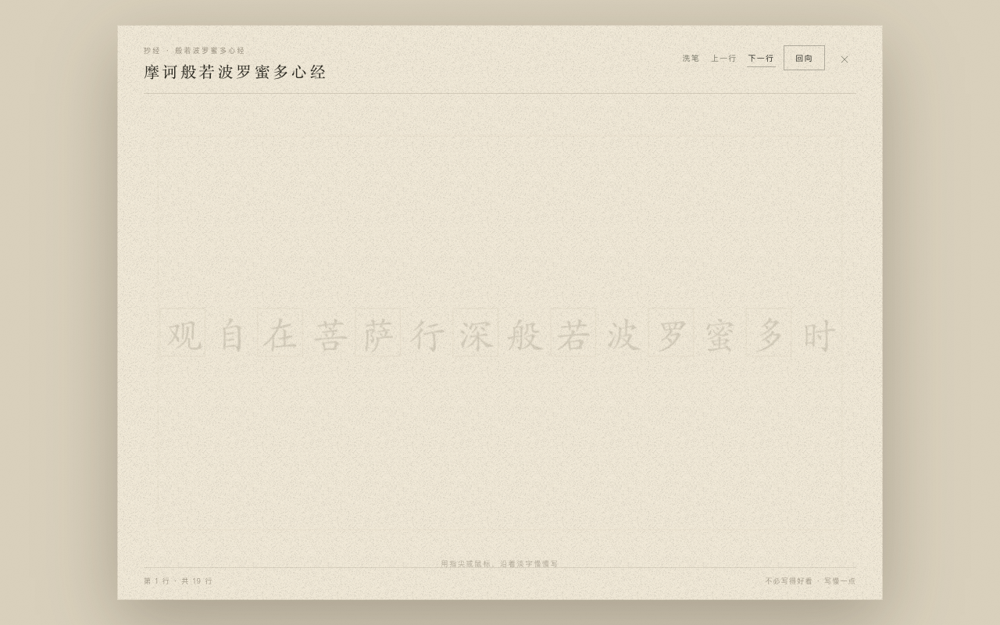
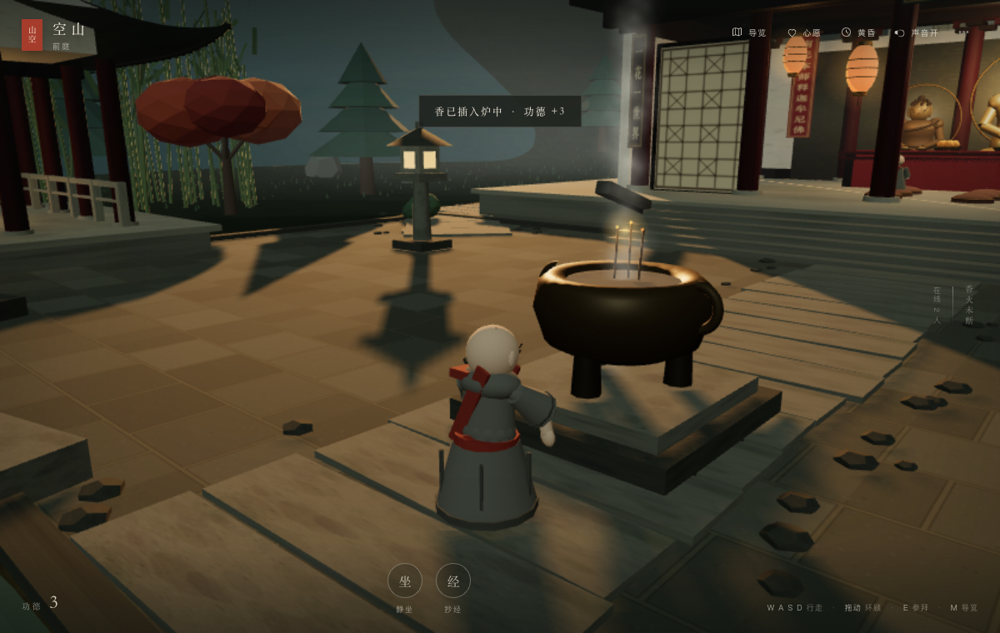
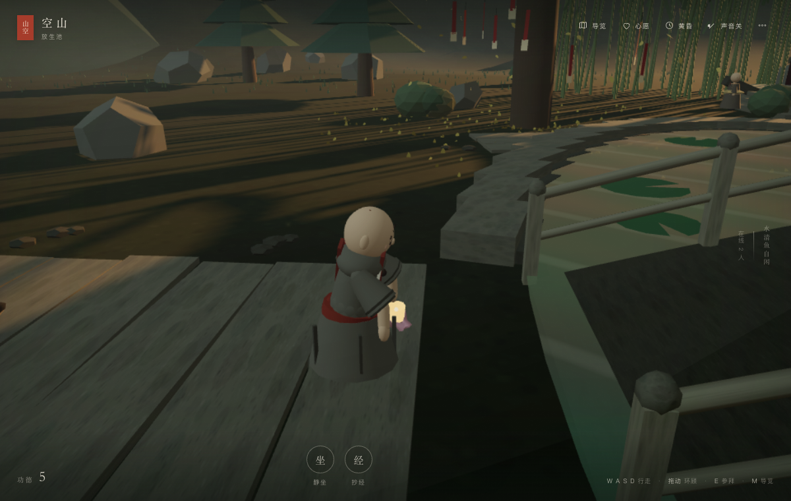

# 空山 · 一座随时可以进去的中国寺庙

> 山门常开，各自安静。  
> 不必说话，也不必解释。点一炷香，敲三下木鱼，和陌生人一起，在大殿前坐一会儿。

空山是一间用 WebGL 程序化生成的数字寺院。它不是游戏，没有任务、等级或排行榜；它更像一个可以随时走进去、待三分钟再出来的地方。受韩国线上寺院 [산사 Sansatemple](https://sansatemple.com/) 的“无声同坐”启发，空山把上香、礼佛、木鱼、求签、供灯、系红绸、撞钟、抄经、诵经、静坐这些中国寺院里很轻的动作，放进了一座黄昏的山里。

**在线体验**：<http://127.0.0.1:5200>（`npm run build && npm run serve`，含实时占座；`npm run dev` 为 <http://127.0.0.1:5199>，无实时服务）



| 前庭 | 夜里 | 求签 |
| --- | --- | --- |
|  |  |  |

| 诵经 · 自动 | 心愿 | 抄经 |
| --- | --- | --- |
|  |  |  |

| 上香 | 放灯 |
| --- | --- |
|  |  |

## 里面有什么

一座完整的寺院，和十二件可以做的事：

| 地点 | 可以做什么 | 细节 |
| --- | --- | --- |
| 香炉 | **上香** | 按 E 角色直接走到炉前插三支香，香头亮起、冒烟；之后可再留一句 40 字以内的话。 |
| 大雄宝殿 | **礼佛** | 在佛前合掌、三拜；木鱼与磬声会跟着动作响。 |
| 大殿右侧 | **敲木鱼** | 每敲一声功德 +1，声音由 WebAudio 实时合成。 |
| 钟楼 / 鼓楼 | **撞钟 / 击鼓** | 角色走到钟/鼓前，手持撞木或鼓槌；人和木槌、钟鼓一起动。钟声有很长的尾音，鼓声有中频鼓皮，手机也能听见。 |
| 藏经阁前 | **求签** | 摇观音灵签，抽一支，读一段今解。一日一签。 |
| 藏经阁前 | **抄经** | 在纸上用指尖或鼠标描《心经》，可以回向。 |
| 放生池 | **放灯** | 选颜色、写一句话，莲灯会漂在池上。 |
| 银杏树下 | **系红绸** | 把一句话系在枝上，风会吹动它。 |
| 大殿蒲团 | **诵经** | 选《心经》《金刚经》《阿弥陀经》《普门品》和时长；角色会自己找一张空蒲团坐下，手里拿木鱼和木槌，自动诵经、自动敲木鱼；有低音诵经声床。念完起身。 |
| 大殿蒲团 | **静坐** | 3 / 5 / 10 / 20 分钟，跟着圆圈呼吸；镜头会安静下来。 |
| 七层塔 | **绕塔** | 走到塔边按 E，角色会沿塔慢慢走一匝，结束时功德 +5。 |
| 石碑、莲灯、红绸 | **读碑 / 读愿** | 点击可以读到山里留下的旧话。 |

还有四处闲笔：钟鼓楼、七层塔、藏经阁、放生池与石桥，以及会在院子里慢慢走动的过客、一只猫、香灰、落叶和萤火。

走路有边界：不能下水、不能穿墙或钻桌子；万一半步卡住，会自动挪出来，也可以按 `R` 回山门。

## 操作

- **行走**：`W A S D` / 方向键 / 点击地面 / 移动端左下摇杆
- **环顾**：拖动画面；滚轮或双指缩放
- **参拜**：走近后按 `E`，或点提示 / 移动端右下按钮
- **诵经**：走进大殿，靠近蒲团按 `E`，选经与 5/15/30 分钟；角色会自己走过去坐下，自动诵经、敲木鱼。`空格` 或「木鱼」按钮可以跟着敲，`起身` 可提前结束。
- **回山门**：`R`（万一卡住）
- **导览**：`M`（含绕塔）；**心愿**：`H`；**静坐**：`Q`；**抄经**：`J`；**诵经**：蒲团前 `E`；**时辰**：`T`；**声音**：`P`
- `Esc` 关闭面板 / 结束静坐

> 提示：第一次进入会花一点时间编译着色器，尤其在使用集成显卡的电脑上。请让「正在立梁」的加载页把山门搭完；之后是流畅的。声音默认在点「入山」后打开，可随时关闭。

## 四个时辰

黄昏、清晨、日午、入夜。每一种都换了天空、雾、阳光、月光、灯火和虫鸟。入夜后，小沙弥手里会提一盏灯。

## 九个蒲团

大殿里九个蒲团，其中一个留给“常住”，其余是真人座位。

- 坐下诵经时，服务端先占座；两个人同时进山，会在殿里看到对方坐在另一张蒲团上。
- 座位满了会提示“蒲团都有人了，在山里等一会儿再来”。
- 起身、取消、关掉页面都会释放座位。
- 在线人数是真实的 WebSocket 连接数；院里慢慢走的过客仍是程序生成的，不计入人数。

## 技术与边界

- **Three.js + TypeScript + Vite**，没有外部 3D 模型和贴图库；寺院、佛像、树、水、云、粒子全部由代码生成。
- **WebAudio** 实时合成钟、磬、木鱼、鼓、风、水、鸟、虫与低频梵音，没有音频文件；诵经时另有一层低音人声感的声床，莲灯入水、点香、脚步都有独立声音。
- **轻量在线**：`server.mjs` 只同步九个蒲团的占用和在线人数；没有账号、没有聊天、没有位置同步，不记录 IP。心愿、红绸、莲灯、签文、功德、访问次数仍只写入浏览器 `localStorage`。
- **自适应分辨率**：每 2 秒测量一次帧率，在 0.7–1.35 倍像素比之间调整；`?hq=1` 可锁定高质量（适合截图）。
- **无障碍**：键盘可完成全部主要操作；支持系统「减少动态效果」；面板有焦点管理。

### 已知限制

- 首次加载的着色器编译在部分集成显卡上较慢（可能 10–25 秒），已用加载页遮住。
- 页面上的「在线 N 人」是当前真实连接数（含你），不含院落里程序生成的“常住与过客”。
- 九个蒲团里有一个是常住，其余由真人实时先到先得；两个人同时进山，会看到对方坐下。满座时会提示“蒲团都有人了”。
- 静态预览（`npm run preview`）没有在线服务，会自动退回单人模拟；完整体验请用 `npm run serve`。
- 手机端的摇杆同时支持 PointerEvent 与 TouchEvent；华为/iPhone 自带浏览器如果指针事件不完整，会走 touch 兜底。
- 在线部分只共享“哪个蒲团有人”和在线人数；没有位置、没有聊天、没有账号系统。这是刻意的：空山希望安静。
- 签文取民间流传的观音灵签前二十签，今解为本站重写，仅供自省，不构成任何建议。

## 本地运行

```bash
npm install
npm run dev        # http://127.0.0.1:5199
npm run build      # 类型检查 + 生产构建
npm run serve      # http://127.0.0.1:5200（静态站点 + 实时占座）
npm run preview    # 仅静态预览，无实时占座
```

公网临时链接通过 Cloudflare Quick Tunnel 指向 `npm run serve` 的 5200 端口。

## 部署到 Cloudflare Pages

- 连接 GitHub 仓库 `haoyangyuying/kongshan`；
- 构建命令：`npm run build`；
- 输出目录：`dist`；
- Node 版本：22（Vite 7 需要 Node 20.19+）。

注意：`server.mjs` 是本地 Node 服务，Cloudflare Pages 只托管静态站点，不会运行它。部署到 Pages 后，页面、3D、声音都正常，但蒲团占座会退化为单人模拟；要保留真人占座，需要另外部署 Node 服务并用命名隧道，或改成 Cloudflare Durable Object。


需要 Node 20+。

## 项目结构

```
kongshan/
├── server.mjs                  # 静态站点 + WebSocket 占座 / 在线人数
├── index.html                  # 开场、HUD、面板、经卷、静坐的 DOM 骨架
├── src/
│   ├── main.ts                 # 渲染循环、输入、交互、存档、状态
│   ├── net/presence.ts         # 在线人数与九个蒲团的占座客户端
│   ├── style.css               # 纸张 / 墨 / 朱砂的界面系统
│   ├── core/
│   │   ├── audio.ts            # 程序化声景
│   │   ├── camera.ts           # 第三人称 / 开场 / 静坐镜头
│   │   └── player.ts           # 小沙弥移动、动作、夜灯
│   ├── world/
│   │   ├── world.ts            # 寺院总装、时辰、NPC、灯与绸、互动点
│   │   ├── arch.ts             # 屋顶举折、斗拱、殿、山门、塔、钟鼓、桥
│   │   ├── interior.ts         # 三世佛、供桌、幡、蒲团、殿内灯
│   │   ├── nature.ts           # 地形、山、云、银杏、竹、池、粒子
│   │   ├── monk.ts             # 小沙弥与过客的程序化骨架
│   │   ├── materials.ts        # 材质与几何助手
│   │   ├── textures.ts         # 瓦、纸、石、匾额、窗棂等程序纹理
│   │   └── optimize.ts         # 静态网格合并
│   ├── ui/ui.ts                # 面板、心愿墙、求签、抄经、静坐
│   └── data/content.ts         # 签文、心愿种子、禅语、心经
├── docs/DESIGN.md              # 调研、设计推导、技术与限制
└── docs/screenshots/           # 截图
```

## 调研与致谢

- 韩国线上寺院 **산사 Sansatemple**（sansatemple.com）：2026 年 10 月 26 日公开，11 天累计约 150 万访问；无注册、无聊天，每日 05:00 / 18:00 共听早课晚课；由 26 岁的开发者用 AI 编程工具完成。空山在“无声同坐”的体验结构上参考了它，但建筑、文字、声音、交互与实现均为独立创作。
- 中文互联网的「电子木鱼」：把功德 +1 当作一种自嘲式的自我安慰。空山保留了木鱼，但把它放回寺院，不让它变成计分游戏。
- 中国汉传佛教寺院的常见形制：歇山屋顶、斗拱、朱柱、放生池、钟鼓楼、七层塔、银杏、心经与观音灵签。
- 签诗取自民间流传的观音灵签（前二十签），今解为本站重写；《心经》为公有领域经典。

详细调研与设计推导见 [docs/DESIGN.md](docs/DESIGN.md)。

## 免责声明

空山是一处虚构的数字寺院，不是真实宗教场所，与任何宗教团体无关，也不提供宗教服务、法事、占卜或医疗建议。若你正在经历难以独自承受的事，请优先寻求现实中的人与专业帮助。

---

空山 · 二〇二六年冬 · 独立完成
